<p align="center">
  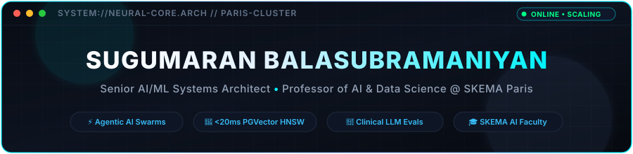
</p>

<p align="center">
  <a href="https://github.com/Sugumaran-Balasubramaniyan">
    
  </a>
</p>

<p align="center">
  <a href="https://www.sugumaran-balasubramaniyan.com"></a>
  <a href="https://sugumaranbalasubramaniyan.substack.com/"></a>
  <a href="https://www.linkedin.com/in/sugumaranbalasubramaniyan"></a>
  <a href="https://x.com/sugumaran___"></a>
  <a href="https://www.youtube.com/@sugumaran_balasubramaniyan"></a>
  <a href="https://huggingface.co/sugumaran"></a>
  <a href="mailto:bsugumaran@hotmail.com"></a>
</p>

<p align="center">
  
</p>

I am **Sugumaran**, a **Senior AI/ML Systems Architect**, **Professor of AI & Data Science** at **SKEMA Business School**, and **Ambassador for ETSI, RAISE Summit, and MACHINA Summit** based in **Paris, France**. I bridge deep machine learning research with hardened production engineering—architecting autonomous multi-agent swarms, deterministic guardrail firewalls, and sub-20ms hybrid vector search engines at scale.

```yaml
# ─── EXECUTIVE TELEMETRY & SYSTEM IDENTITY ───────────────────────────
architect:
  name: "Sugumaran Balasubramaniyan"
  roles:
    - "Senior AI/ML Systems Architect & Enterprise Consultant"
    - "External Professor of AI & Data Science @ SKEMA Business School (Paris)"
    - "Ambassador @ ETSI (European Telecommunications Standards Institute)"
    - "Ambassador @ RAISE Summit Paris (Generative AI)"
    - "Founding Ambassador @ MACHINA Summit (Physical AI & Embodied Intelligence)"
  location: "Paris, France 🇫🇷"
  experience: "7+ Years (Production MLOps, LLM Systems, Enterprise ML)"
  education:
    - "MSc in Data Science & AI Strategy — emlyon business school"
    - "Global Academic Exchange — McGill University (Montréal)"
    - "MBA & B.Tech — Pondicherry University"
  credentials: "15 Professional Certifications (4x AWS, 3x NVIDIA, 3x Databricks)"

core_specializations:
  agentic_orchestration:
    - "Autonomous Multi-Agent Swarms & Task-Graph Execution Loops"
    - "Deterministic Guardrail Firewalls, Sandbox Isolation & Tool Telemetry"
  retrieval_and_rag:
    - "Sub-20ms Hybrid PGVector HNSW Search (Dense Embeddings + BM25 Sparse)"
    - "Multi-Stage Document Decomposition, Cross-Encoder Re-Ranking"
  clinical_evaluations:
    - "Adversarial LLM-as-Judge Protocols & Automated Hallucination Detection"
    - "Medical Diagnostic Benchmarking Suites (MedQA, USMLE 4-Option Ground Truth)"
  production_infrastructure:
    - "High-Throughput Model Serving (vLLM, Ollama, Triton) & Async FastAPI Backends"
    - "Zero-Downtime Containerized Deployments (Docker, Kubernetes, AWS EKS, Actions)"

mission_statement: >
  Bridging rigorous academic research with production-grade engineering. 
  Architecting deterministic, secure, and ultra-low-latency AI systems at scale.
```

<p align="center">
  
</p>

<p align="center">
  <a href="https://github.com/Sugumaran-Balasubramaniyan/enterprise-agentic-rag"></a>
  <a href="https://github.com/Sugumaran-Balasubramaniyan/clinical-llm-eval"></a>
</p>
<p align="center">
  <a href="https://github.com/Sugumaran-Balasubramaniyan/hermes-agent"></a>
  <a href="https://github.com/Sugumaran-Balasubramaniyan/Advanced-Machine-Learning"></a>
</p>

<p align="center">
  
</p>

<p align="center">
  <a href="https://www.skema.edu"></a>
  <a href="https://github.com/Sugumaran-Balasubramaniyan/Python-for-Data-Science"></a>
</p>

<details open>
  <summary><b>🏛️ Academic Chair Scope &amp; Research Focus @ SKEMA Business School (Paris Campus)</b></summary>
  <br/>
  <blockquote>
    <i>"Empowering the next generation of AI systems architects and quantitative data scientists through rigorous theoretical grounding and production-grade engineering excellence."</i>
  </blockquote>

  <ul>
    <li><b>Advanced Machine Learning &amp; Predictive Analytics:</b> Directing postgraduate MSc curricula on ensemble architectures, gradient boosted decision trees (XGBoost/LightGBM), neural networks, probabilistic estimation, and Explainable AI (SHAP / LIME).</li>
    <li><b>Generative AI &amp; Agentic Systems in Business:</b> Designing applied masterclasses on enterprise RAG implementations, multi-model evaluation harnesses, and deterministic AI governance.</li>
    <li><b>Clinical Diagnostic Reasoning &amp; AI Safety:</b> Conducting applied research on adversarial LLM-as-judge protocols, term-matching hallucination detection, and medical ground-truth verification.</li>
    <li><b>Postgraduate Mentorship:</b> Supervising 500+ master's theses, capstone projects, and applied industry research partnerships with European technology leaders.</li>
  </ul>
</details>

<p align="center">
  
</p>

<p align="center">
  <a href="https://www.sugumaran-balasubramaniyan.com/engineering-log.html"></a>
  <a href="https://www.sugumaran-balasubramaniyan.com/#about"></a>
</p>

<p align="center">
  
</p>

<p align="center">
  
</p>

<table width="100%">
  <tr>
    <td width="33%" valign="top">
      <b>🧠 LLM Systems &amp; AI Architecture</b><br/><br/>
      
      
      <br/>
      
      
      <br/>
      
      
    </td>
    <td width="33%" valign="top">
      <b>⚡ Cloud Infrastructure &amp; 15 Certs</b><br/><br/>
      
      <br/>
      
      <br/>
      
      <br/>
      
      
    </td>
    <td width="34%" valign="top">
      <b>📊 Data Systems &amp; Vector Stores</b><br/><br/>
      
      <br/>
      
      <br/>
      
      <br/>
      
      
    </td>
  </tr>
</table>

<p align="center">
  
</p>

<p align="center">
  <a href="https://github.com/Sugumaran-Balasubramaniyan"></a>
  <a href="mailto:bsugumaran@hotmail.com"></a>
</p>

<p align="center">
  
</p>

<p align="center">
  <a href="https://www.sugumaran-balasubramaniyan.com"></a>
  <br/><br/>
  <i>"The best way to predict the future is to architect and build it."</i>
  <br/>
  <sub>© Sugumaran Balasubramaniyan • Paris, France</sub>
</p>
